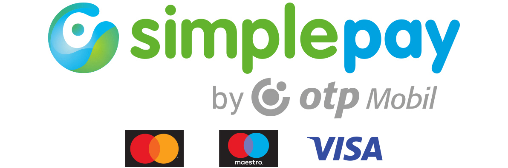

# SimplePay JS SDK

[English README](README-ENG.md)

Egy pehelysúlyú segédprogram a magyarországi SimplePay fizetések integrálásához Node.js alkalmazásokban.



További információkért kérlek, olvasd el a [SimplePay dokumentációt](https://simplepay.hu/fejlesztoknek).

> 🫵 Ha a csomag hasznos a számodra, akkor ne feletjs el rányomni a star-ra GitHub-on.

## Telepítés

```bash
# npm
npm install simplepay-js-sdk

# yarn
yarn add simplepay-js-sdk

# pnpm
pnpm add simplepay-js-sdk
```

## Konfiguráció

Állítsd be a következő környezeti változókat a `.env` fájlban:

- `SIMPLEPAY_LOGGER` Ha `true`-ra van állítva, naplózza a változókat - csak hibakereséshez hasznos.
- `SIMPLEPAY_MERCHANT_KEY_HUF` A te SimplePay titkos kereskedői kulcsod. Állítsd be a `SIMPLEPAY_MERCHANT_KEY_HUF_SZEP` értéket SZÉP kártyás fizetésekhez. Állítsd be a `SIMPLEPAY_MERCHANT_KEY_EUR` és `SIMPLEPAY_MERCHANT_KEY_USD` értékeket EUR és USD fizetések elfogadásához.
- `SIMPLEPAY_MERCHANT_ID_HUF` A SimplePay kereskedői azonosítód. Állítsd be a `SIMPLEPAY_MERCHANT_ID_HUF_SZEP` értéket SZÉP kártyás fizetésekhez. Állítsd be a `SIMPLEPAY_MERCHANT_ID_EUR` és `SIMPLEPAY_MERCHANT_ID_USD` értékeket EUR és USD fizetések elfogadásához.
- `SIMPLEPAY_PRODUCTION` Ha `true`-ra van állítva, éles környezetet használ, egyébként teszt környezetet.
- `SIMPLEPAY_REDIRECT_URL` A weboldalad URL-je, ahova a vásárló átirányításra kerül a fizetés után. Ez a fizetés indításakor is megadható, így különböző redirect url-eket definiálhatsz különböző fizetésekhez.

## Használat

Három végpontot kell létrehoznod: egyet a fizetés indításához, egyet a fizetési válasz fogadásához és egyet az IPN kezeléséhez.

### Egyszeri fizetés

#### Fizetés indítása végpont

```typescript
import { startPayment } from 'simplepay-js-sdk'

try {
  const response = await startPayment({
    orderRef: 'order-12',
    total: 1212,
    currency: 'HUF', // opcionális, HUF | HUF_SZEP | EUR | USD, alapértelmezett: HUF
    customerEmail: 'rrd@webmania.cc',
    language: 'HU', // opcionális, AR | BG | CS | DE | EN | ES | FR | IT | HR | HU | PL | RO | RU | SK | TR | ZH, alapértelmezett: HU
    method: 'CARD', // opcionális, CARD | WIRE, alapértelmezett: CARD
    invoice: {
      name: 'Radharadhya Dasa',
      country: 'HU',
      state: 'Budapest',
      city: 'Budapest',
      zip: '1234',
      address: 'Sehol u. 0',
    },
  }, {
    redirectUrl: 'http://url.to.redirect' // opcionális, alapértelmezetten a SIMPLEPAY_REDIRECT_URL környezeti változó értéke
  })
  return response
} catch (error) {
  console.error('Fizetés indítása sikertelen:', error)
  return error
}
```

A `response.paymentUrl` tartalmazza a SimplePay fizetési URL-t, ahova a vásárlót át kell irányítani.

#### Fizetési válasz fogadása végpont

Amikor a vásárló visszatér a SimplePay fizetési oldalról, a fizetési választ a `SIMPLEPAY_REDIRECT_URL` címen kell fogadni. Az URL két paramétert tartalmaz: `r` és `s`.

```typescript
import { getPaymentResponse } from 'simplepay-js-sdk'

// az "r" és "s" paraméterek kinyerése az URL-ből az alkalmazásod és keretrendszerének megfelelően

const response = getPaymentResponse(r, s)
```

A `response` a következő tulajdonságokkal rendelkezik:

- `responseCode`: `0` siker esetén, vagy hibakód
- `transactionId`: a tranzakció azonosítója
- `event`: az esemény típusa: `success` | `fail` | `timeout` | `cancel`
- `merchantId`: a kereskedő azonosítója
- `orderRef`: a rendelés azonosítója

#### IPN végpont

A SimplePay `POST` kérést küld az IPN URL-re, és válaszolnunk kell rá.

**Ajánlott megközelítés a `handleIpnRequest` függvénnyel:**

```typescript
import { handleIpnRequest } from 'simplepay-js-sdk'

// Az IPN végpont kezelőjében (pl. Express, Next.js, stb.)
const ipnBody = await request.text() // A nyers body stringként (FONTOS: használd a .text()-et, ne a JSON.parse()-t)
const incomingSignature = request.headers.get('Signature')
const { MERCHANT_KEY } = getSimplePayConfig('HUF') // vagy a te valutád

const { responseBody, signature } = handleIpnRequest(ipnBody, incomingSignature, MERCHANT_KEY)

// KRITIKUS: A responseBody-t pontosan úgy küldd el, ahogy visszaadódott, NE módosítsd!
// NE:
// - Formázd újra vagy "szépítsd" a JSON-t
// - Parse-old és stringify-zd újra a JSON-t
// - Adj hozzá szóközöket vagy formázást
// Bármilyen módosítás érvényteleníti az aláírást!

// Válasz küldése HTTP 200 státusszal
return new Response(responseBody, {
  status: 200,
  headers: {
    'Content-Type': 'application/json',
    'Signature': signature
  }
})
```

**Manuális megközelítés:**

Ha manuálisan szeretnéd kezelni:

- ellenőrizd az aláírás érvényességét - használd a `checkSignature(ipnBody, signatureHeader, SIMPLEPAY_MERCHANT_KEY_HUF)` függvényt
- adj hozzá egy `receiveDate` tulajdonságot a kapott JSON-hoz (ISO 8601 formátumban, pl. `2025-10-06T07:00:34+02:00`)
- számítsd ki az új aláírást - használd a `generateSignature(responseText, SIMPLEPAY_MERCHANT_KEY_HUF)` függvényt
- küldd el a `response`-t az új `signature`-rel a HTTP fejlécben (ne a JSON body-ban)
- **Fontos**: A válasz JSON-nak tömörnek kell lennie (szóközmentes). A `JSON.stringify()` alapból tömör JSON-t ad vissza.

### Google Pay

A kereskedő oldalán megjelenő Google Pay gombhoz a böngészős segéd és a SimplePay `doGooglePay` hívás kell. A rendelést az IPN alapján teljesítsd. 3DS kihívás után a SimplePay a `redirectUrl` címre küldi vissza a vásárlót `r` és `s` paraméterekkel, amit a `getPaymentResponse` ellenőriz. Ha nincs 3DS kihívás, a vásárló a fizetési oldalon marad.

A terhelés összege az a `total`, amit a szerver ad át a `startGooglePay` függvénynek. A Google Pay lapon látható összeg a vásárlónak szól.

Élesítés előtt hozz létre kereskedői profilt a Google Pay & Wallet Console-ban, hagyasd jóvá a pénztár domainjét, és küldd el a Google kereskedői azonosítót a SimplePay-nek. `gatewayMerchantId` értékként a SimplePay kereskedői azonosítót add meg. A sandbox a `TEST` Google Pay környezetet használja.

#### Böngészős gomb

```typescript
import { renderGooglePayButton } from 'simplepay-js-sdk/google-pay'

await renderGooglePayButton({
  container: '#google-pay',
  merchantId: 'YOUR_GOOGLE_MERCHANT_ID',
  merchantName: 'Shop Name',
  environment: 'TEST', // TEST | PRODUCTION
  gatewayMerchantId: 'YOUR_SIMPLEPAY_MERCHANT_ID',
  authorizationEndpoint: '/api/google-pay',
  currency: 'HUF',
  total: '1212',
  orderRef: 'order-12',
  onResult: (result) => {
    console.log(result)
  },
  onError: (error) => {
    console.error(error)
  },
})
```

A gomb a `{ googlePayToken, orderRef }` JSON-t küldi az `authorizationEndpoint` címre. A `googlePayToken` már base64. Ezt az értéket változtatás nélkül add át a `startGooglePay` függvénynek.

#### Szerver

A rendelést a szerveren olvasd ki, és azt az összeget terheld. A SimplePay választ küldd vissza a böngészőnek. Ha a válasz `3004` hibakódot és `redirectUrl` címet tartalmaz, a gomb a 3DS kihívásra viszi a vásárlót.

```typescript
import { startGooglePay } from 'simplepay-js-sdk'

const order = await loadOrder(orderRef)
const response = await startGooglePay({
  orderRef: order.orderRef,
  total: order.total,
  currency: 'HUF',
  customerEmail: order.email,
  language: 'HU',
  googlePayToken, // a böngészőből kapott base64 token
}, {
  redirectUrl: 'https://yoursite.com/payment/callback',
})
return response
```

A `HUF_SZEP` nem használható Google Pay-hez. Éles környezetben a visszatérési URL abszolút `https` cím legyen.

### Ismétlődő fizetés

#### Ismétlődő fizetés indítása végpont

Itt a `startRecurringPayment()` függvényt kell használnod, ami ugyanúgy működik, mint a `startPayment()`. Az egyetlen különbség, hogy két további tulajdonságot kell megadni: `customer` és `recurring`.

```typescript
try {
  const response = await startRecurringPayment({
    // ... egyéb tulajdonságok
    customer: 'Radharadhya Dasa',
    recurring: {
      times: 3, // hányszor történik meg a fizetés, tokenek száma
      until: '2025-12-31T18:00:00+02:00', // az ismétlődő fizetés végdátuma - használd a toISO8601DateString() segédfüggvényt
      maxAmount: 100000 // az ismétlődő fizetés maximális összege
    }
  })
}
```

A válasz egy további `tokens` tulajdonsággal rendelkezik, ami tartalmazza a regisztrált kártyák tokenjeit.
A te dolgod a tokenek mentése az adatbázisba, hogy később használhasd őket fizetéshez.

#### Ismétlődő fizetési válasz fogadása végpont

Használd ugyanazt a végpontot, mint az egyszeri fizetésnél.

#### IPN végpont kártyaregisztrációnál

Ugyanúgy működik, mint az egyszeri fizetés `IPN` végpontja.
A válasz ugyanazokkal a tulajdonságokkal rendelkezik, és 2 további tulajdonsággal:

- `cardMask`: xxxx-xxxx-xxxx-1234 - a regisztrált kártya maszkolt száma
- `expiry`: 2025-01-31T00:00:00+02:00 - a regisztrált kártya lejárati dátuma

#### Tokenes fizetés

Miután egy kártya regisztrálva van, használhatod a tokeneket fizetéshez felhasználói interakció nélkül, például napi `cron` feladattal

```typescript
import { startTokenPayment } from 'simplepay-js-sdk'

// TODO: fizetési adatok lekérése az adatbázisból, ahol a tokeneket tárolod

const payment = {
  token: '1234567890123456',
  total: 1212,
  currency: 'HUF' as Currency,
  customer: 'Radharadhya Dasa',
  customerEmail: 'rrd@webmania.cc',
  invoice: {
    name: 'Radharadhya Dasa',
    country: 'HU',
    state: 'Budapest',
    city: 'Budapest',
    zip: '1234',
    address: 'Sehol u. 0',
  },
}

try {
  const response = await startTokenPayment({
    orderRef: Date.now().toString(),
    language: 'HU',
    method: 'CARD', // kötelezően CARD
    ...payment,
  })
  return response
} catch (error) {
  console.error('Token fizetés indítása sikertelen:', error)
  return error
}
```

#### Kártya törlése

A fizető ügyfelek számára lehetővé kell tenni, hogy a honlapodon belépve törölni tudja a regisztrált kártyáját.
Ehhez használd a `cancelCard` függvényt. `cardId`-ként a kártya regisztrációs tranzakció SimplePay azonosítóját kell megadnod.

```typescript
import { cancelCard } from 'simplepay-js-sdk'

try {
  const response = await cancelCard(cardId)
  
  if (response.status == 'DISABLED') {
    // A kártya sikeresen törölve
    // TODO: a fel nem használt tokenek és a kártya törlése az adatbázisból
  }
  return response
} catch (error) {
  console.error('Kártya törlése sikertelen:', error)
  return error
}
```

## Agent Skill

Ez a könyvtár elérhető [Agent Skill](https://skills.sh)-ként AI kódoló ágensekhez. Telepítsd, hogy az ágensed ismerje a SimplePay integrációt:

```bash
npx skills add rrd108/simplepay-js-sdk
```

## Licenc

MIT